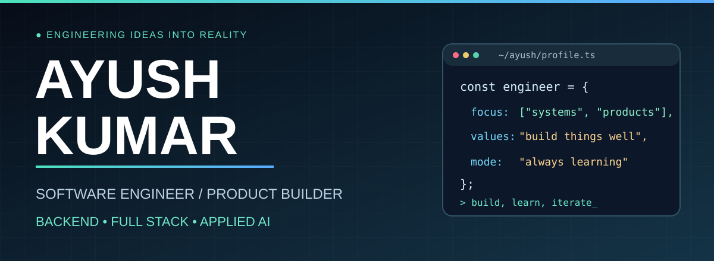
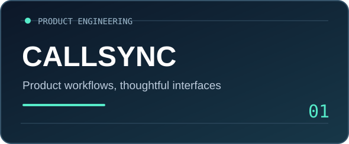
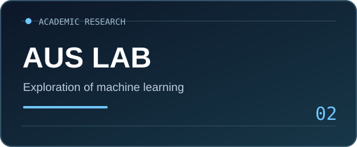
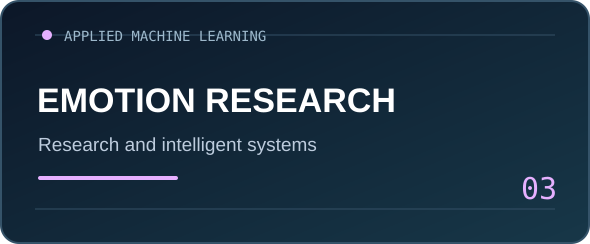
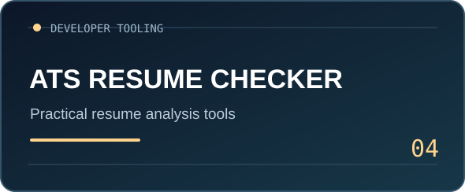

 

  

---

### `01 / the person behind the commits`

I'm a **Computer Science graduate from Eötvös Loránd University (ELTE), Budapest**, focused on **backend engineering, thoughtful product development, and applied AI**.

I enjoy working across the full journey of a product: designing data models, building APIs, connecting intuitive interfaces, and making complicated workflows feel simple.

At **InspectOS / Remixwise**, I worked on **Reserva**, a real estate platform for Portugal. I developed role-based workflows using **TypeScript, React, Node.js, Supabase, and PostgreSQL**.

`backend systems` &nbsp; `full-stack products` &nbsp; `databases & APIs` &nbsp; `applied ML` &nbsp; `developer experience`

### `02 / tools I build with`

**Languages and product engineering**

**Data, infrastructure and workflow**

> Good engineering starts with choosing the right solution, not the longest tool list.

### `03 / selected work`

<table>
<tr>
<td width="50%" valign="top"> <b>CallSync</b> · Product and workflow engineering</td>
<td width="50%" valign="top"> <b>AUS Lab</b> · Academic machine learning exploration</td>
</tr>
<tr>
<td width="50%" valign="top"> <b>Emotion Research</b> · Applied AI research</td>
<td width="50%" valign="top"> <b>ATS Resume Checker</b> · Practical developer tooling</td>
</tr>
</table>

<a href="https://github.com/Ayush-Khemani?tab=repositories"><b>All repositories →</b></a>

### `04 / experience in practice`

**Software Engineering Intern** · **InspectOS / Remixwise** · Mar 2026 to Jul 2026

Contributed to **Reserva**, a platform designed to connect property stakeholders in Portugal. I developed authentication and role permissions, property submission and approval processes, buyer mandates, listing state transitions, and matching workflows.

`TypeScript` `React` `Node.js` `Express` `Supabase` `PostgreSQL`

### `05 / beyond the code`

- **Co-founder**, ELTE Data Science Club. Bringing people together around technical curiosity and shared learning.
- **Academic research**, with interests spanning computer vision, machine learning, and intelligent systems.
- **Currently exploring**, AI-first workflows and ways to turn natural language into useful software actions.

### `06 / the activity log`

Language statistics reflect repository composition, not professional proficiency.

### `07 / connect`

**Good software starts with an interesting problem.** If you are building something thoughtful, I'd love to hear about it.

  

Designed with intention. Built with curiosity. Always improving.

